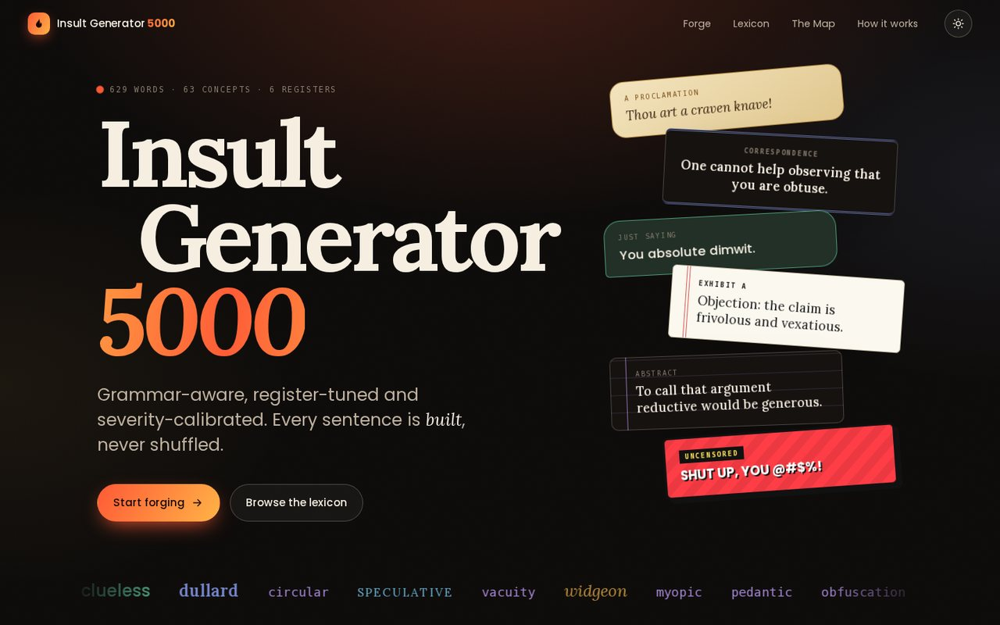
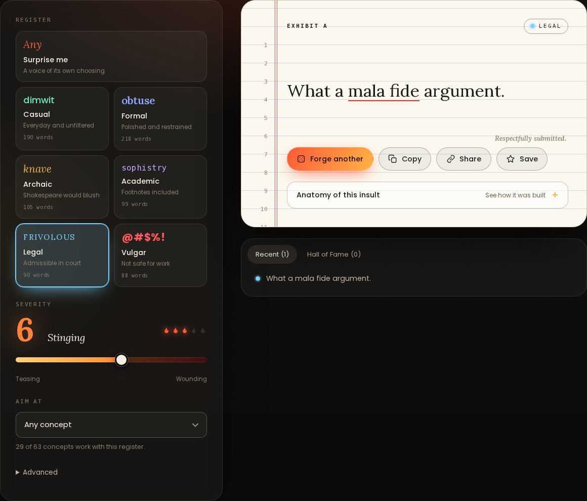

# insult-generator-5000

An algorithmic English insult generator. It builds grammatically sound insults from a curated,
hand-annotated vocabulary: pick a **register**, dial the **severity**, aim at a **concept**.
There is a command line, a JSON API and a React web interface.



> **Status: early development (version 0.1.0).** Generation works end to end, but the
> template set is small and several areas are thin. See [Limitations](#limitations).

## What it does

- **629 vocabulary entries** across **63 semantic concepts** and six registers: casual,
  formal, archaic, academic, legal and vulgar. Each entry records its nuance, severity,
  formality, vulgarity and archaicness.
- **Grammar-aware generation.** 58 typed sentence frames are filled from the vocabulary.
  Slots know what may go in them, so you get "You are a gullible dolt" but never "You are
  fallacious" (an adjective that only describes arguments) or "a balderdash" (a mass noun).
- **Reproducible.** The same settings and seed always rebuild the same insult.
- **A web interface** with a register-themed result stage, a searchable lexicon, a scatter
  plot of the whole vocabulary, and shareable links that recreate an exact insult.



## Quick start

Requires Python 3.12+ (no runtime dependencies) and, for the web interface, Node 20+.

```bash
python -m venv .venv && source .venv/bin/activate
python -m pip install -e ".[dev]"

insultgen generate --register archaic --severity 7 --count 3
insultgen generate --register legal --concept deception --seed 42
```

### Web interface

```bash
cd web && npm install && npm run build && cd ..
insultgen serve            # http://127.0.0.1:8000
```

`insultgen serve` binds to `127.0.0.1` only. See [docs/web.md](docs/web.md) for the API,
the front-end layout and development workflow.

## Command line

```bash
insultgen generate [--register R] [--severity 1-10] [--concept ID] [--seed N] [--count 1-50]
insultgen serve [--host H] [--port P] [--web-dir DIR]
insultgen validate-data [--path FILE]
insultgen --version
```

`generate` exits with status 1 and a message if no insult can fit the settings (for example a
concept the chosen register has no suitable words for).

## How generation works

```
parameters -> register -> frame -> slot filling -> sentence -> validation
```

1. **Register**: the one you asked for, or a random non-vulgar one (vulgar only when requested).
2. **Frame**: a sentence pattern such as `You are {a adj1} {person}.`, preferring frames written
   for that register ("Thou art ...", "I put it to you that ...").
3. **Slot filling**: each slot takes words of the right kind, register and severity, weighted
   toward the target severity and toward words related to the chosen concept.
4. **Sentence**: articles agree (a/an), capitals and punctuation are set.
5. **Validation**: no unfilled slots, no repeated words, correct closing punctuation.

Words flagged `sensitive` are never used; `obsolete` words only appear in the archaic register.
Details are in [docs/architecture.md](docs/architecture.md).

## Repository layout

```
src/insultgen/
  models.py        typed domain models and enums
  validation.py    dataset validation (reports every problem at once)
  loader.py        loads and validates the dataset
  data/            vocabulary.json and vocabulary.schema.json
  generation/      frames, grammar helpers and the generator
  service.py       framework-independent API logic
  server.py        standard-library HTTP server (API + static files)
  cli.py           command-line interface
web/               React front end (esbuild, no other build dependencies)
tests/ docs/ scripts/ examples/
```

## Development

```bash
python -m pytest          # Python tests
python -m ruff check .    # lint
python -m mypy            # type check (strict)

cd web
npm test                  # front-end unit tests (node:test)
npm run watch             # rebuild on change
```

CI runs all of these. [web/e2e/journeys.mjs](web/e2e/journeys.mjs) is an optional browser test
of the main user journeys.

## Adding vocabulary

Edit `src/insultgen/data/vocabulary.json`, then run `insultgen validate-data` and the tests.
Nouns need a `noun_class` and adjectives need `targets`, so the generator knows where they fit.
Read [docs/vocabulary-guidelines.md](docs/vocabulary-guidelines.md) first: the dataset
deliberately excludes slurs and sexual content.

## Limitations

- **Thin spots.** Only 22 of 63 concepts work with the vulgar register, 29 with legal and
  academic, 38 with archaic. The web interface only offers concepts that work.
- **Repetition.** Small word pools (for example abstract nouns in the academic register) repeat
  more often than you would like.
- **Verbs and adverbs** are in the dataset but not used by any frame yet.
- **The vocabulary needs expert review.** Definitions and register labels were written without
  checking a dictionary. Use `python scripts/dataset_report.py` to see what is flagged.
- The built-in server is for local use and demos, not for exposing to the internet.

## Content note

This project is about the craft of insults, in the tradition of Shakespearean insult
generators. The vocabulary targets conduct and character (stupidity, dishonesty, cowardice).
It deliberately excludes slurs aimed at protected characteristics and sexual content. The
`vulgar` register is profanity and crude slang as language, not hate speech.

## License

No license has been chosen yet. See [LICENSE](LICENSE). The bundled fonts have their own
licenses; see [web/public/fonts/README.md](web/public/fonts/README.md).
